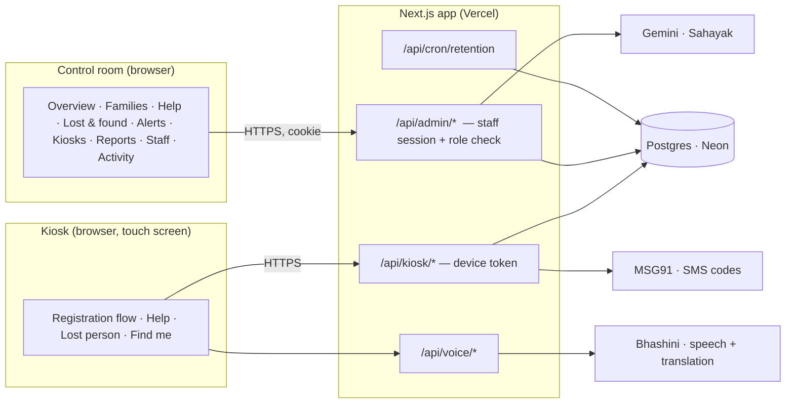

# Sangam Seva · Maha Kumbh crowd management

**Live demo: https://vidhina05.github.io/Kumbh_Crowd_Management/** — runs entirely in your browser (database included), with invented data and simulated sensors. Nothing you type leaves your device. Use **Reset demo** (bottom-right) to start fresh.

Built from the Figma file (*UI · Admin* and *UI · Kiosk* pages), screen by screen:

- **Registration kiosk** (`/kiosk`): a family registers for a safe bathing slot in **any of 24 languages** — the 22 languages of the Eighth Schedule, English and Bhojpuri — and the whole screen, including right-to-left Urdu, Kashmiri and Sindhi, switches. Each screen is **read aloud in the chosen language**. Identity by **Aadhaar Secure QR** (UIDAI signature checked) or a phone code; optional, consented **face matching** to find a separated family member or a lost pass. Pass with QR and wristbands, help requests, missing-person reports, "Find me", offline outbox.
- **Control room** (`/admin`): staff sign in with their staff ID and **face scan** (opt-in, 1:1) or PIN/password, plus a 6-digit code where required; pick a command post and start a shift. Live aerial map in 2D/3D with crowd pins from **crowd sensors and camera counters**, ghat detail with replay and forecast, batch plan, two-person **diversions** that reach families on the kiosk and their phone, families, help requests with nearest-helper dispatch, lost & found with face search, multilingual alerts, shift report and handover, Sahayak assistant, wall view, settings sheet.
- **Camera crowd counter** (`/camera`): any phone or webcam counts faces in view on the device and posts only the number. It never identifies anyone.
- **My pass** (`/pass`): a pilgrim checks their pass and any ghat change on their own phone.

> **Status.** Every screen above works end to end in the live demo and passes a 36-step browser click-through (see [Tests](#tests)). Services that need your accounts — Bhashini (server voice), Gemini (Sahayak AI), MSG91 (SMS) and the UIDAI certificate — are wired in and **say "not connected" on screen until you add keys**; nothing is faked. Translations other than English are drafts awaiting native-speaker review.

## How it fits together



Data flows one way: what a family enters at a kiosk (members, wristbands, slot, consent, which kiosk) is what staff see in Families, linked to any help request or lost-person case. Details: [docs/ARCHITECTURE.md](docs/ARCHITECTURE.md).

## Run it on your computer

Needs Node.js 20.9 or newer. No database install: locally it uses an embedded Postgres in `./.data`.

```bash
npm install
cp .env.example .env.local
# Fill the four secrets in .env.local:
#   openssl rand -base64 32   (three times: DATA_ENCRYPTION_KEY, LOOKUP_HMAC_KEY, SESSION_SECRET)
#   openssl rand -hex 24      (CRON_SECRET)
# For local testing set OTP_DEV_MODE=true so phone codes show on screen.

SEED_ADMIN_EMAIL=you@example.org SEED_ADMIN_PASSWORD='choose-a-long-password-1' npm run setup
npm run dev
```

`npm run setup` creates the tables, five ghats with bathing slots for 8 days, your super-admin account and kiosk **K-17**. It prints K-17's device token once. Then:

1. Open http://localhost:3000/admin and sign in.
2. Open http://localhost:3000/kiosk, enter `K-17` and the token. The kiosk is ready.

Lost the token? Admin → Kiosks → **New token**.

## Deploy from GitHub (Vercel + Neon)

1. **Database.** Create a free project at [neon.com](https://neon.com). Copy the pooled connection string (it ends with `?sslmode=require`).
2. **Import the repo** at [vercel.com/new](https://vercel.com/new). Vercel detects Next.js; `vercel.json` sets the build command (`npm run vercel-build`, which runs migrations, seeds ghats and slots, then builds).
3. **Environment variables** (Vercel → Project → Settings → Environment Variables). Add everything from `.env.example`:
   - `DATABASE_URL` from Neon; the four generated secrets; `RETENTION_HOURS=48`; `SMS_PROVIDER=none` until you have MSG91.
   - For the first deploy only: `SEED_ADMIN_EMAIL` and `SEED_ADMIN_PASSWORD`. Remove them afterwards.
   - Keep `OTP_DEV_MODE=false`. The app refuses to start in production if it's `true`.
4. **Deploy.** You get a link like `https://kumbh-crowd-management.vercel.app`.
5. **Add kiosks** in Admin → Kiosks. Each kiosk shows its token once; enter it on the device at `/kiosk?setup=1`.
6. **Data deletion job.** `vercel.json` runs `/api/cron/retention` once a day at 03:00 IST (Vercel sends `CRON_SECRET` automatically). On a paid plan, change it to hourly: `"0 * * * *"`.

Every push to `main` redeploys. Pull requests get preview links.

> **Plans.** Vercel's free Hobby plan is for personal, non-commercial use. A real Mela deployment needs Vercel Pro ($20/month per seat) or another host. Neon's free plan has 0.5–1 GB of storage and suspends compute when its monthly allowance runs out. Use a paid plan for the event. Costs: [docs/AI-LANGUAGES-KIOSK.md](docs/AI-LANGUAGES-KIOSK.md#costs).

## Connect the optional services

| Service | What it turns on | How to get keys | Env vars |
|---|---|---|---|
| **Bhashini** (Govt. of India, free) | Server voice in all 22 scheduled languages (read-aloud and voice input) | bhashini.gov.in/ulca → My Profile → API key | `BHASHINI_USER_ID`, `BHASHINI_API_KEY` |
| **Google Gemini** | Sahayak answers in plain language (without it, Sahayak still answers from live numbers) | aistudio.google.com/apikey | `GEMINI_API_KEY` |
| **MSG91** | SMS codes, pass, diversion and thank-you messages | msg91.com + DLT-registered templates | `SMS_PROVIDER=msg91`, `MSG91_*` |
| **UIDAI certificate** | Real Aadhaar Secure QR verification | uidai.gov.in (offline verification) | `AADHAAR_UIDAI_CERT_PEM` |
| **Upstash Redis** | Rate limits shared across server instances | upstash.com (free tier) | `UPSTASH_REDIS_REST_URL`, `UPSTASH_REDIS_REST_TOKEN` |

**Voice without Bhashini.** The kiosk uses the device's own voices: the exact language if the device has it, otherwise a voice that reads the same script (a Hindi voice for Maithili, Sanskrit, Bhojpuri, Dogri, Konkani, Nepali and Bodo; an Urdu voice for Kashmiri and Sindhi), and says which voice it used. If a device has no suitable voice, the kiosk says so and shows everything on screen. Chrome on Android and Windows has Indian-language voices for Hindi, Bengali, Tamil, Telugu, Kannada, Malayalam, Marathi, Gujarati, Urdu and others; Odia, Assamese, Manipuri and Santali usually need Bhashini. Voice input uses Bhashini when configured, otherwise the browser's recognizer (Chrome sends that audio to Google).

These integrations follow each provider's published API, but they have **not been tested against the live services** (no keys were available). Test them with real keys before the event.

## Roles

| Role | Can do |
|---|---|
| Super admin | Everything, including staff accounts, kiosks and the activity log |
| Operations | Families, help, lost & found, alerts, crowd counts, reports, Sahayak |
| Crowd control | Crowd counts, alerts, Sahayak; view help requests |
| Help desk | Families, help requests, lost & found |
| Medical | Medical help requests; view the others |

Roles are checked on the server for every API call; hiding a button is never the only protection. The full matrix is in `src/shared/rbac.ts`.

## Tests

```bash
npm run typecheck
npm test                       # unit + API tests, including all 24 dictionaries (every key, every placeholder)
npm run build:pages            # the static demo in ./out
SITE=http://localhost:8765/Kumbh_Crowd_Management node tests/e2e/clickthrough.mjs   # 36-step click-through in Chrome
npm audit
```

The click-through registers a family with an Aadhaar test card and a face template, books a slot, finds the pass again by QR and by face, takes the phone-code path, sends help and a missing-person report, switches through all 24 languages (checking text and right-to-left), signs into the control room, holds and reopens a gate, uses the 2D/3D map, plans a diversion that the same person can't approve, approves it as someone else, sees it on the kiosk and the public pass page, registers a sensor and counts faces from a camera, runs a face search in lost & found through to reunion, hands over a shift, asks Sahayak, opens every page, dispatches a helper, changes settings, turns on two-step sign-in and signs in with it, checks a help-desk account's limits, and resets the demo. Camera tests use fake video feeds (`FACE_FEED`, `FACE_JPG`, `CROWD_FEED`).

## Project layout

```
src/app/kiosk          kiosk page
src/app/admin          sign-in + dashboard pages ((app) = signed-in area)
src/app/api            API routes (kiosk, admin, voice, cron, health)
src/kiosk              kiosk UI, offline outbox, voice
src/admin              dashboard shell, polling, case tools
src/server             config, crypto, auth, database, services, integrations
src/i18n               kiosk text in 24 languages (one complete dictionary each)
src/shared             roles, validation, languages, time helpers
migrations             SQL migrations (source of truth for the schema)
scripts                migrate, seed, secret check
tests                  unit, API and browser tests
docs                   architecture, API, security, AI and language decisions
```

## What's not done yet

- **Live keys** for Bhashini, Gemini, MSG91 and the UIDAI certificate (see above).
- **Native-speaker review** of the 23 non-English dictionaries. Bodo, Kashmiri, Sindhi, Manipuri (Meetei Mayek) and Santali (Ol Chiki) need the most care. Ghat names and walking notes come from the database in English and Hindi only; non-Devanagari languages show the English name.
- **Wristband hardware.** Wristband IDs are generated; there's no pairing with a real band or dispenser, so the kiosk says "gets a wristband" rather than "band connected".
- **Crowd sensors** are an open HTTP ingest API with per-device keys; the demo uses a labelled simulator and the camera counter. Real gate counters need integrating with that API.
- **Face recognition** is opt-in and 1:1 / opted-in families only: staff sign-in and the find-me / lost-and-found search. There is deliberately no crowd-wide face identification.
- **Real-time** uses polling (5–10 s); push can come later.
- **Load and penetration testing** haven't been done.

Security review and pre-push checklist: [docs/SECURITY.md](docs/SECURITY.md).
