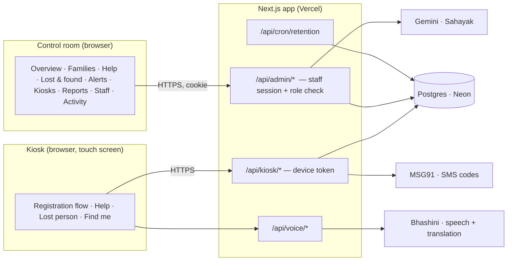

# Sangam Seva · Maha Kumbh crowd management

Two connected products built from the Figma designs:

- **Registration kiosk** (`/kiosk`): pilgrims register their family for a safe bathing slot in 10 Indian languages, get a pass with a QR code and wristbands, ask for help or report a missing person. Works by touch, with voice when connected.
- **Control room** (`/admin`): staff see today's registrations and crowd levels, work help requests and lost-person cases, publish alerts to kiosks, manage kiosks and staff. Role-based, every action logged.

One Next.js app holds the kiosk, the admin dashboard and the API, backed by Postgres. It deploys straight from GitHub to a live link on Vercel.

> Status: core features are built and tested (31 automated API/unit tests, 27 browser journeys). Voice (Bhashini), the Sahayak assistant (Gemini) and SMS (MSG91) are wired in but **not connected until you add keys**. Until then the app says so on screen; it never fakes them. See [What's not done yet](#whats-not-done-yet).

## How it fits together



Data flows one way: what a family enters at a kiosk (members, wristbands, slot, consent, which kiosk) is what staff see in Families, linked to any help request or lost-person case. Details: [docs/ARCHITECTURE.md](docs/ARCHITECTURE.md).

## Run it on your computer

Needs Node.js 20.9 or newer. No database install: locally it uses an embedded Postgres in `./.data`.

```bash
npm install
cp .env.example .env.local
# Fill the four secrets in .env.local:
#   openssl rand -base64 32   (three times: DATA_ENCRYPTION_KEY, LOOKUP_HMAC_KEY, SESSION_SECRET)
#   openssl rand -hex 24      (CRON_SECRET)
# For local testing set OTP_DEV_MODE=true so phone codes show on screen.

SEED_ADMIN_EMAIL=you@example.org SEED_ADMIN_PASSWORD='choose-a-long-password-1' npm run setup
npm run dev
```

`npm run setup` creates the tables, five ghats with bathing slots for 8 days, your super-admin account and kiosk **K-17**. It prints K-17's device token once. Then:

1. Open http://localhost:3000/admin and sign in.
2. Open http://localhost:3000/kiosk, enter `K-17` and the token. The kiosk is ready.

Lost the token? Admin → Kiosks → **New token**.

## Deploy from GitHub (Vercel + Neon)

1. **Database.** Create a free project at [neon.com](https://neon.com). Copy the pooled connection string (it ends with `?sslmode=require`).
2. **Import the repo** at [vercel.com/new](https://vercel.com/new). Vercel detects Next.js; `vercel.json` sets the build command (`npm run vercel-build`, which runs migrations, seeds ghats and slots, then builds).
3. **Environment variables** (Vercel → Project → Settings → Environment Variables). Add everything from `.env.example`:
   - `DATABASE_URL` from Neon; the four generated secrets; `RETENTION_HOURS=48`; `SMS_PROVIDER=none` until you have MSG91.
   - For the first deploy only: `SEED_ADMIN_EMAIL` and `SEED_ADMIN_PASSWORD`. Remove them afterwards.
   - Keep `OTP_DEV_MODE=false`. The app refuses to start in production if it's `true`.
4. **Deploy.** You get a link like `https://kumbh-crowd-management.vercel.app`.
5. **Add kiosks** in Admin → Kiosks. Each kiosk shows its token once; enter it on the device at `/kiosk?setup=1`.
6. **Data deletion job.** `vercel.json` runs `/api/cron/retention` once a day at 03:00 IST (Vercel sends `CRON_SECRET` automatically). On a paid plan, change it to hourly: `"0 * * * *"`.

Every push to `main` redeploys. Pull requests get preview links.

> **Plans.** Vercel's free Hobby plan is for personal, non-commercial use. A real Mela deployment needs Vercel Pro ($20/month per seat) or another host. Neon's free plan has 0.5–1 GB of storage and suspends compute when its monthly allowance runs out. Use a paid plan for the event. Costs: [docs/AI-LANGUAGES-KIOSK.md](docs/AI-LANGUAGES-KIOSK.md#costs).

## Connect the optional services

| Service | What it turns on | How to get keys | Env vars |
|---|---|---|---|
| **Bhashini** (Govt. of India, free) | Read-aloud and voice typing in Indian languages | Register at bhashini.gov.in/ulca → My Profile → API key | `BHASHINI_USER_ID`, `BHASHINI_API_KEY` |
| **Google Gemini** | Sahayak, the control-room assistant | aistudio.google.com/apikey | `GEMINI_API_KEY` (`GEMINI_MODEL` defaults to `gemini-2.5-flash`) |
| **MSG91** | SMS phone codes | msg91.com, then DLT registration of a template with `##OTP##` | `SMS_PROVIDER=msg91`, `MSG91_AUTH_KEY`, `MSG91_TEMPLATE_ID` |

After adding keys, redeploy, then check:
- **Voice:** on the kiosk, the guide pane shows **Read aloud** instead of "Voice is not available", and the help text box shows **Speak**.
- **Sahayak:** Admin → **Ask Sahayak** answers instead of "not connected".
- **SMS:** register with your own number; the code arrives by SMS and is not shown on screen.

These three integrations follow each provider's published API, but they have **not been tested against the live services** (no keys were available while building). Test them with real keys before the event.

## Roles

| Role | Can do |
|---|---|
| Super admin | Everything, including staff accounts, kiosks and the activity log |
| Operations | Families, help, lost & found, alerts, crowd counts, reports, Sahayak |
| Crowd control | Crowd counts, alerts, Sahayak; view help requests |
| Help desk | Families, help requests, lost & found |
| Medical | Medical help requests; view the others |

Roles are checked on the server for every API call; hiding a button is never the only protection. The full matrix is in `src/shared/rbac.ts`.

## Tests

```bash
npm run typecheck
npm test                      # 31 unit + API tests on an in-memory database
npm run build && npm run test:e2e   # 27 journeys in Chrome (set CHROME_PATH if Chrome isn't at /usr/bin/google-chrome)
npm run lint:secrets          # blocks commits that contain keys, passwords or .env files
npm audit
```

What the browser tests cover: kiosk setup; registering a family of three with a camera photo; choosing a slot; the pass and QR code; medical help; a missing child; a help request made **offline** that's sent when the connection returns; "Find me" and a slot change; switching to Tamil and English; admin sign-in and wrong password; the family appearing in the dashboard with its wristbands and source kiosk; working a help request to resolved; a lost-child case linked to the family's photo and reunited, with the photo view logged; an alert reaching the kiosk; kiosk online status; Sahayak saying it's not connected; dark theme; a help-desk account blocked from staff management; phone-width layouts.

## Project layout

```
src/app/kiosk          kiosk page
src/app/admin          sign-in + dashboard pages ((app) = signed-in area)
src/app/api            API routes (kiosk, admin, voice, cron, health)
src/kiosk              kiosk UI, offline outbox, voice
src/admin              dashboard shell, polling, case tools
src/server             config, crypto, auth, database, services, integrations
src/i18n               kiosk text in 10 languages
src/shared             roles, validation, languages, time helpers
migrations             SQL migrations (source of truth for the schema)
scripts                migrate, seed, secret check
tests                  unit, API and browser tests
docs                   architecture, API, security, AI and language decisions
```

## What's not done yet

Built and tested: everything above. Not done, by decision or because it needs you:

- **Live keys** for Bhashini, Gemini and MSG91 (see above). Without SMS, phone codes can't be delivered in production; staff can still help pilgrims who can't verify.
- **Aadhaar scanning** (shown in the Figma kiosk) is not built. Reading Aadhaar needs a UIDAI-licensed partner (AUA/KUA). The kiosk uses phone verification instead.
- **Face recognition** is deliberately not built. Photos of children are taken only with consent, encrypted, shown to staff only for an open lost-child case, and deleted 48 h after the slot. Why, and how to add consent-based face verification later: [docs/AI-LANGUAGES-KIOSK.md](docs/AI-LANGUAGES-KIOSK.md#face-recognition).
- **Crowd numbers are entered by staff.** No sensors or camera analytics are connected, and the dashboard says so with the time of each entry.
- **Translations:** English is the source. The other 9 languages are complete drafts that need review by native speakers before launch. Kiosk alerts are shown in the language staff type them in.
- **Real-time updates** use 10-second polling, which is simple and reliable on serverless hosting. Push (WebSockets) can come later.
- **Rate limits** are kept in memory per server instance; add a shared store (e.g. Upstash Redis) when running many instances. Login lockout and OTP limits are already stored in the database.
- **Pass printing** uses the browser's print dialog; a kiosk needs its printer set as default in kiosk mode. Wristband IDs are generated by the server; a real dispenser would scan its own IDs.
- Screens from the Figma file not yet built: Admin batch plan, diversion planner, 3D view, shift report and wall view; Kiosk Aadhaar scan.

Security review and pre-push checklist: [docs/SECURITY.md](docs/SECURITY.md).
