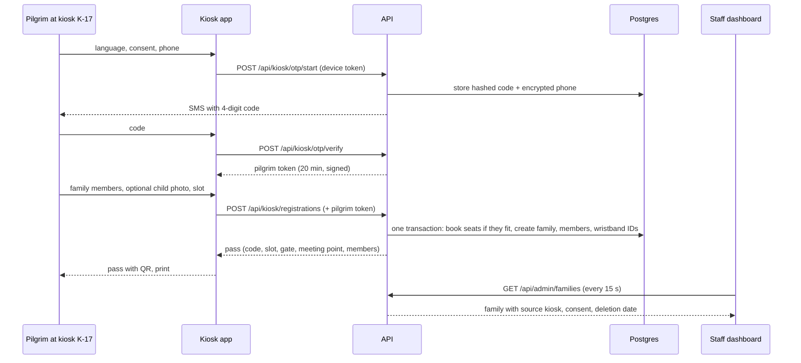
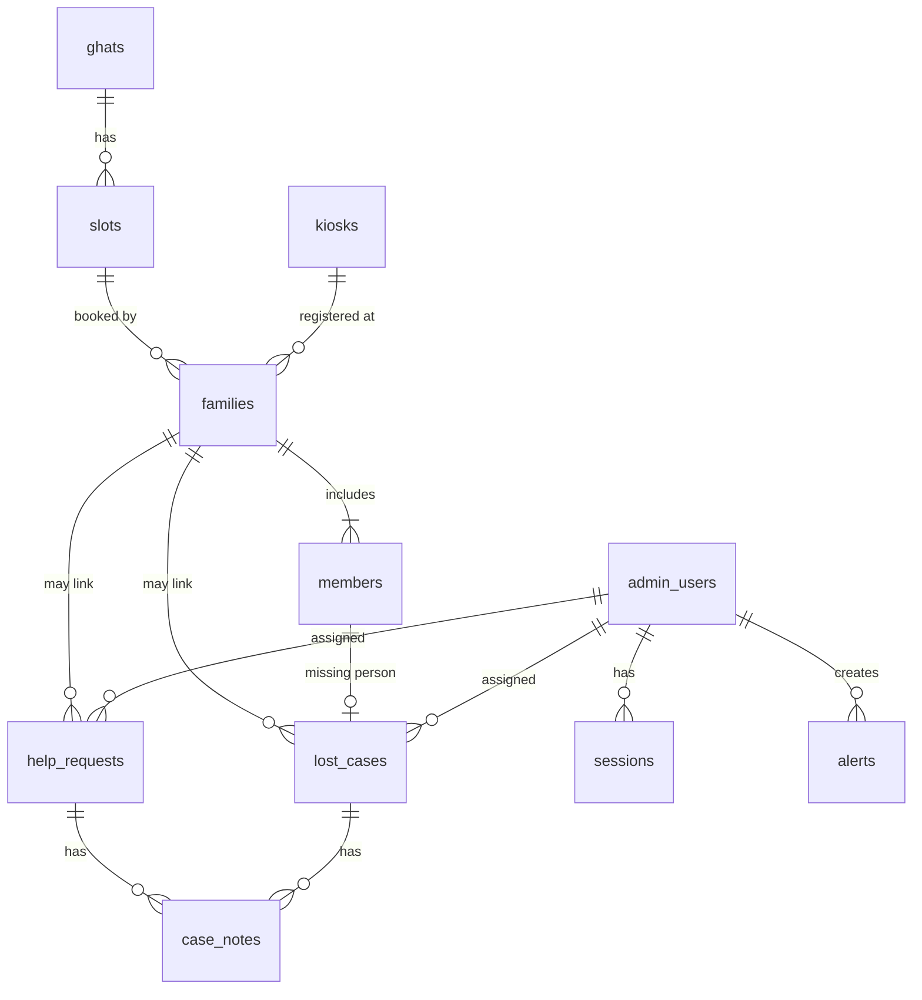

# Architecture, data model and API

## Components

| Part | Technology | Notes |
|---|---|---|
| Kiosk UI | React (Next.js client component) | Touch-first, 10 languages, offline outbox, 60 s idle reset |
| Admin UI | React (Next.js App Router) | Server checks the session before rendering; pages poll every 8–15 s |
| API | Next.js route handlers (Node.js runtime) | zod validation on every input, consistent JSON errors |
| Database | Postgres (Neon in production, embedded PGlite locally) | Drizzle ORM; SQL migrations in `migrations/` |
| Voice / translation | Bhashini ULCA pipeline API | Server-side only; kiosk falls back to the browser voice, then to text |
| Assistant | Google Gemini (`gemini-2.5-flash`) | Gets an aggregate, PII-free snapshot; suggestions only |
| SMS | MSG91 OTP API | Optional; dev mode shows codes on screen (refused in production) |
| Scheduling | Vercel Cron | Daily data-deletion job |

## How a registration flows

Help requests and missing-person reports follow the same path into `help_requests` / `lost_cases`. Kiosks retry them from an offline outbox; the `clientRequestId` makes retries safe (no duplicates).

## Data model

| Table | Holds | Personal data and how it's protected |
|---|---|---|
| `ghats` | Name, gate, capacity, current count, **source** (`manual`/`sensor`), who entered it and when, meeting point | None |
| `slots` | 30-min bathing windows per ghat per day, capacity, seats booked (a CHECK constraint stops overbooking) | None |
| `kiosks` | ID, location, **hash** of the device token, last heartbeat | None |
| `families` | Pass code, leader name, slot, kiosk, language, consent version and time, photo consent, `delete_after` | Phone: AES-256-GCM (`phone_enc`) + keyed HMAC for lookup (`phone_hash`) + last 4 digits for display |
| `members` | Name, age, relation, needs, wristband ID | Child photo: AES-256-GCM, only with consent |
| `otp_challenges` | Hashed code, attempts, expiry | Encrypted phone; deleted after 24 h |
| `help_requests` | Type, details, priority, status, assignee, kiosk, linked family | Free-text details (staff should avoid writing identifying details) |
| `lost_cases` | Missing person's name, age, clothes, where last seen, reporter, status, linked family/member | Reporter phone encrypted; names and descriptions blanked 48 h after closing |
| `case_notes` | Staff notes on cases | Written by staff |
| `alerts` | Severity, message, ghat, audience (staff / kiosk / both), status | None |
| `admin_users` | Email, name, role, bcrypt password hash (cost 12), lockout counters | Staff work email |
| `sessions` | **SHA-256 of** the session token, expiry, last activity | None |
| `audit_log` | Who did what, when; never personal data | None |

Retention: `/api/cron/retention` deletes families (with members and photos) whose `delete_after` has passed (slot end + `RETENTION_HOURS`, default 48), blanks closed lost-person cases after the same period, and removes old OTP challenges and expired sessions.

## API reference

All responses are JSON. Errors look like `{ "error": { "code": "slot_full", "message": "…" } }`. Status codes: 400 invalid input, 401 not signed in / bad device token, 403 role not allowed or cross-site request, 404, 409 conflict (full slot, already registered, bad status change), 413 too large, 423 account locked, 429 too many requests, 503 integration not connected.

### Kiosk (headers `X-Kiosk-Id`, `X-Kiosk-Token`)

| Method | Path | Body / query | Returns |
|---|---|---|---|
| GET | `/api/kiosk/config` | — | Kiosk identity, active kiosk alerts, crowd levels with source and age, which integrations are on |
| POST | `/api/kiosk/heartbeat` | `{ version }` | `{ ok }` — marks the kiosk online for 90 s |
| GET | `/api/kiosk/slots` | `?day=YYYY-MM-DD` (today … +7) | Ghats with slots and places left |
| POST | `/api/kiosk/otp/start` | `{ phone }` | `{ challengeId, phoneLast4, sms, devCode? }` — max 3 per number per 10 min |
| POST | `/api/kiosk/otp/verify` | `{ challengeId, code }` | `{ pilgrimToken }` — max 5 tries per code |
| POST | `/api/kiosk/registrations` | + `X-Pilgrim-Token`; `{ language, consent, homeTown, slotId, members[] }` | Pass. 409 if the slot filled up or the phone already has a registration |
| GET | `/api/kiosk/registrations/me` | + `X-Pilgrim-Token` | The family's current pass |
| POST | `/api/kiosk/registrations/change-slot` | + `X-Pilgrim-Token`; `{ slotId }` | New pass with `replaces` (one change allowed) |
| POST | `/api/kiosk/help` | `{ type, description, passCode?, clientRequestId }` | `{ code, status }` (idempotent) |
| POST | `/api/kiosk/lost` | `{ personName, age?, description, lastSeen, reporterName, reporterPhone?, clientRequestId }` (+ optional pilgrim token to link the family) | `{ code, linkedToFamily }` |
| POST | `/api/voice/tts` | `{ text, lang }` | `{ audio (base64 WAV) }` or 503 if not connected |
| POST | `/api/voice/asr` | `{ audio (base64 16 kHz WAV), lang }` | `{ text }` or 503 |

### Admin (session cookie `sc_session`, SameSite=Strict; changes must come from the same origin)

| Method | Path | Permission |
|---|---|---|
| POST | `/api/admin/auth/login` `{ email, password }` · `/api/admin/auth/logout` | — |
| GET | `/api/admin/me` | signed in |
| GET | `/api/admin/overview` · `/api/admin/slots?day=` | overview.view |
| GET | `/api/admin/families?q=` · `/api/admin/families/:id` | families.view |
| PATCH | `/api/admin/families/:id` `{ status }` | families.update |
| GET | `/api/admin/help?status=&type=` · `/api/admin/help/:id/notes` | help.view |
| PATCH | `/api/admin/help/:id` `{ status?, assignedTo?, priority? }` · POST notes | help.update (medical: medical requests only) |
| GET | `/api/admin/lost?status=&q=` · notes | lost.view |
| GET | `/api/admin/lost/:id/photo` (open cases only, logged) | lost.view |
| PATCH | `/api/admin/lost/:id` `{ status?, assignedTo?, passCode?, memberId? }` · POST notes | lost.update |
| GET / POST | `/api/admin/alerts` · POST `/api/admin/alerts/:id/resolve` | alerts.view / alerts.manage |
| PATCH | `/api/admin/ghats/:id` `{ occupancy }` | ghats.update |
| GET | `/api/admin/kiosks` | kiosks.view |
| POST / PATCH | `/api/admin/kiosks` · `/:id` · `/:id/rotate` | kiosks.manage |
| GET / POST / PATCH | `/api/admin/users` · `/:id` | users.manage |
| GET | `/api/admin/staff` | help.update or lost.update |
| GET | `/api/admin/reports` | reports.view |
| GET | `/api/admin/audit` | audit.view |
| POST | `/api/admin/assistant` `{ question }` | assistant.use |

### Other

| Method | Path | Notes |
|---|---|---|
| GET | `/api/health` | `{ ok, db }` for uptime monitors; reveals no configuration |
| GET | `/api/cron/retention` | `Authorization: Bearer $CRON_SECRET` |

## Scaling notes

- The app is stateless apart from Postgres, so it scales horizontally on Vercel. Use Neon's **pooled** connection string.
- Seat booking is one atomic `UPDATE … WHERE booked + n <= capacity`, so concurrent kiosks can't overbook.
- Polling every 10 s from ~50 staff screens and ~200 kiosks every 30–60 s is roughly 10–15 requests/second. That's well within one Postgres instance. Add indexes before adding caches.
- For more instances, move the in-memory rate limiter to Redis (Upstash) and consider Server-Sent Events for alerts.
